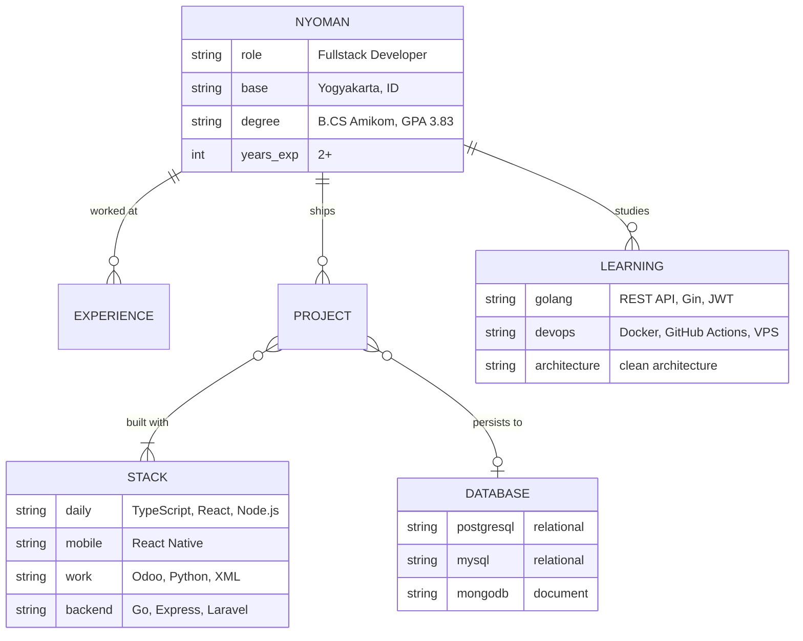
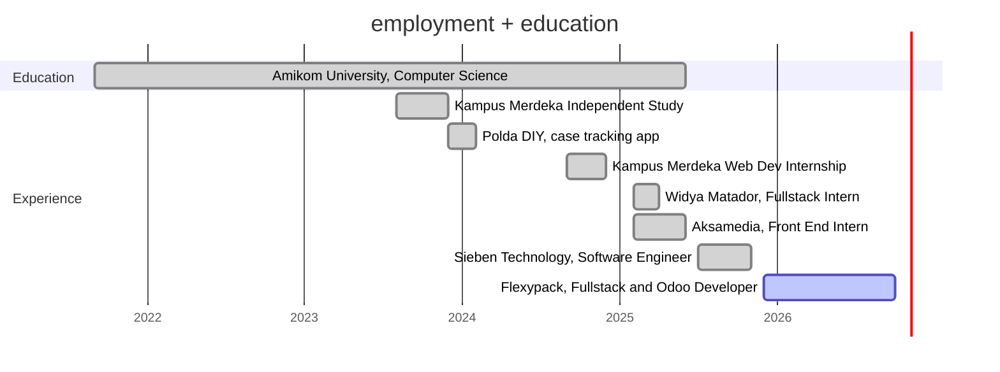
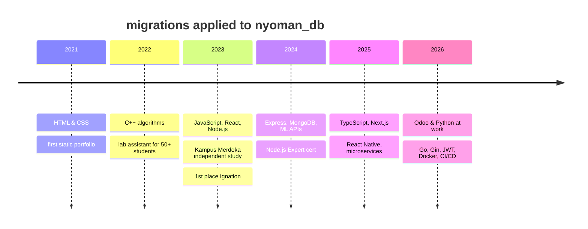

<!--
  Tema: profil sebagai database.
  Semua diagram memakai Mermaid, dirender langsung oleh GitHub tanpa server pihak ketiga.
  Baris bertanda TODO: isi dengan link repo yang benar sebelum commit.
-->

```sql
-- connected to github.com/Marst313
-- server: Yogyakarta, Indonesia (UTC+7)

SELECT name, role, current_company, status
FROM   developers
WHERE  username = 'Marst313';
```

| name | role | status |
|---|---|---|---|
| **I Nyoman Karma Dharma Nalendra Wardana** | Fullstack Developer · JS/TS, Go, Odoo | `ACTIVE` |

```
(1 row returned in 0.313 ms)
```

---

### `\d nyoman` · describe schema

Saya membangun aplikasi web dan mobile dari ujung ke ujung: antarmuka dengan **React / React Native / Next.js**, API dengan **Node.js**, dan sekarang **Go**. Di kantor saya menulis modul **Odoo** (Python) untuk alur kerja internal, seperti permintaan akses user dan approval berjenjang. Di luar kantor, saya senang membongkar hal yang ada di balik layar: skema database, migrasi, auth, dan pipeline deploy.



---

### `SELECT * FROM stack ORDER BY daily_use DESC;`

| layer | tools |
|---|---|
| `frontend` |       |
| `mobile` |  |
| `backend` |      |
| `erp` |   |
| `database` |     |
| `devops` |      |

---

### `SELECT * FROM employment ORDER BY started_at;`



<details>
<summary><code>SELECT company, highlight FROM employment;</code></summary>

<br>

| company | role | highlight |
|---|---|---|
| **Flexypack** · Yogyakarta | Fullstack & Odoo Developer | Modul Odoo kustom; fitur *Request Access User* dengan approval workflow untuk izin menu dan modul |
| **Sieben Technology** · remote | Software Engineer | Upgrade React Native dari v0.63 ke v0.79; fitur di arsitektur microservices |
| **Aksamedia** · remote | Front End Intern | Desain Figma menjadi UI React responsif; integrasi REST API |
| **Widya Matador** · remote | Fullstack Intern | Komponen React + TypeScript; API dan dokumentasi untuk produk IoT |
| **Kampus Merdeka** (Infinite Learning) | Web Dev Intern | Aplikasi peringkas teks berbasis ML: Node.js, Express, MongoDB, RBAC |
| **Reskrimsus Polda DIY** | Developer | Aplikasi pelacakan kasus internal dan dashboard analitik |

</details>

---

### `SELECT * FROM projects WHERE featured = true;`

| project | what it does | stack | link |
|---|---|---|---|
| **Reminder API** | REST API pengingat dengan auth JWT, migrasi skema, cron job yang mereset tugas selesai, unit test, dan CI/CD ke VPS | `Go` `Gin` `PostgreSQL` `Docker` `GitHub Actions` | [repo](https://github.com/Marst313/learn-go) |
| **Portfolio** | Situs portofolio dengan filter dan pencarian proyek | `Next.js` `Tailwind` `Airtable` | [repo](https://github.com/Marst313/portofolio) · [live](https://inyomandharma.vercel.app/) |
| **ML Text Summarizer** | Aplikasi peringkas teks dengan integrasi model ML dan role-based access | `React` `Node.js` `Express` `MongoDB` | <!-- TODO --> [repo](https://github.com/Marst313/TODO) |
| **Child Growth Monitor** 🥇 | Juara 1 Ignation Software Development Competition: memantau tumbuh kembang anak | `React` `Node.js` | <!-- TODO --> [repo](https://github.com/Marst313/TODO) |

---

### `SELECT * FROM schema_migrations;` · learning journey



<details>
<summary><code>SELECT * FROM certifications;</code></summary>

<br>

| certification | issuer | year |
|---|---|---|
| Junior Web Developer | Kominfo | 2023 |
| React 18 Complete Guide | Udemy | 2023 |
| Cloud Practitioner Essentials | Dicoding | 2023 |
| Node.js Expert | Udemy | 2024 |

</details>

---

### `SELECT stats FROM github;`

<div align="center">
  
  
</div>

---

### `INSERT INTO conversations (you, me) VALUES (?, ?);`

[](https://inyomandharma.vercel.app/)
[](https://www.linkedin.com/in/i-nyoman-karma-dharma-nalendra-wardana/)
[](mailto:dlegoinyoman1@gmail.com)
[](https://www.instagram.com/inyoman_dharma/)

```
COMMIT;  -- terima kasih sudah mampir ☕
```
