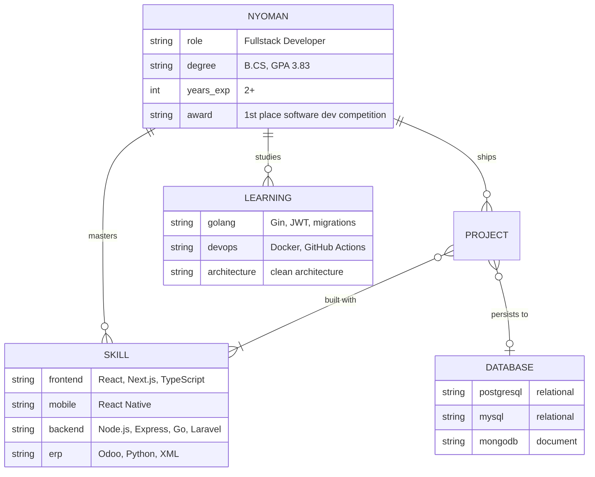
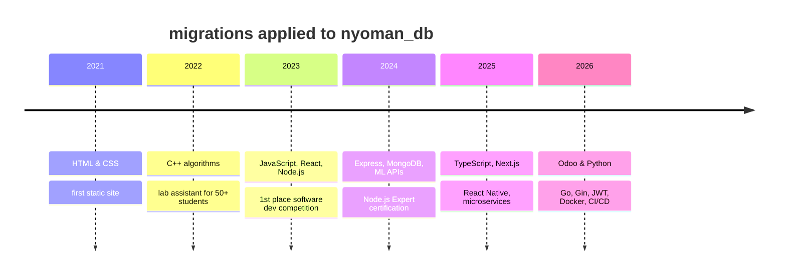

<!--
  Theme: profile as a database.
  All diagrams use Mermaid, rendered natively by GitHub (no third-party servers).
  Rows marked TODO: fill in from your portfolio before committing.
-->

```sql
-- connected to github.com/Marst313
-- server: Indonesia (UTC+7)

SELECT name, role, experience, status
FROM   developers
WHERE  username = 'Marst313';
```

| name | role | experience | status |
|---|---|---|---|
| **I Nyoman Karma Dharma Nalendra Wardana** | Fullstack Developer · JS/TS · Go · Odoo | `2+ years` | `OPEN_TO_COLLABORATE` |

```
(1 row returned in 0.313 ms)
```

---

### `\d nyoman` · describe schema

I build web and mobile apps end to end: interfaces with **React, React Native and Next.js**, APIs with **Node.js** and lately **Go**, and business modules in **Odoo (Python)**. What I enjoy most is the layer underneath — schemas, migrations, auth, and the pipeline that ships it all.



---

### `SELECT * FROM skills ORDER BY daily_use DESC;`

| layer | tools | what I do with them |
|---|---|---|
| `frontend` |       | Figma-to-React UIs, reusable typed components, responsive layouts |
| `mobile` |  | Upgrading legacy apps across major versions (0.63 → 0.79) |
| `backend` |      | REST APIs, JWT auth, role-based access, microservices |
| `erp` |   | Custom modules, access-request and approval workflows |
| `database` |     | Schema design, migrations, query tuning |
| `devops` |      | Containerized deploys, CI/CD to VPS |

<details>
<summary><code>SELECT concept FROM skills WHERE type = 'practice';</code></summary>

<br>

`REST API design` · `Clean Architecture` · `MVC` · `OOP` · `Role-based access control` · `Unit testing` · `Agile / Scrum` · `Code review`

</details>

---

### `SELECT * FROM projects WHERE featured = true;`

<!-- TODO: add the rest of your portfolio projects here, one row each: name | what it does | stack | links -->

| project | what it does | stack | links |
|---|---|---|---|
| **Reminder API** | Reminder REST API with JWT auth, schema migrations, a cron job that resets completed tasks, unit tests, and CI/CD to a VPS | `Go` `Gin` `PostgreSQL` `Docker` `GitHub Actions` | [code](https://github.com/Marst313/learn-go) |
| **Portfolio** | Personal site with project search and category filters | `Next.js` `Tailwind` `Airtable` | [code](https://github.com/Marst313/portofolio) · [live](https://inyomandharma.vercel.app/) |
| **TODO project name** | TODO one sentence: the problem it solves | `TODO` | [code](https://github.com/Marst313/TODO) · [live](https://TODO) |
| **TODO project name** | TODO | `TODO` | [code](https://github.com/Marst313/TODO) |

---

### `SELECT * FROM schema_migrations;` · learning journey



<details>
<summary><code>SELECT * FROM certifications;</code></summary>

<br>

| certification | year |
|---|---|
| Junior Web Developer (Kominfo) | 2023 |
| React 18 Complete Guide (Udemy) | 2023 |
| Cloud Practitioner Essentials (Dicoding) | 2023 |
| Node.js Expert (Udemy) | 2024 |

</details>

---

### `SELECT stats FROM github;`

<div align="center">
  
  
</div>

---

### `INSERT INTO conversations (you, me) VALUES (?, ?);`

[](https://inyomandharma.vercel.app/)
[](https://www.linkedin.com/in/i-nyoman-karma-dharma-nalendra-wardana/)
[](mailto:dlegoinyoman1@gmail.com)
[](https://www.instagram.com/inyoman_dharma/)

```
COMMIT;  -- thanks for stopping by ☕
```
