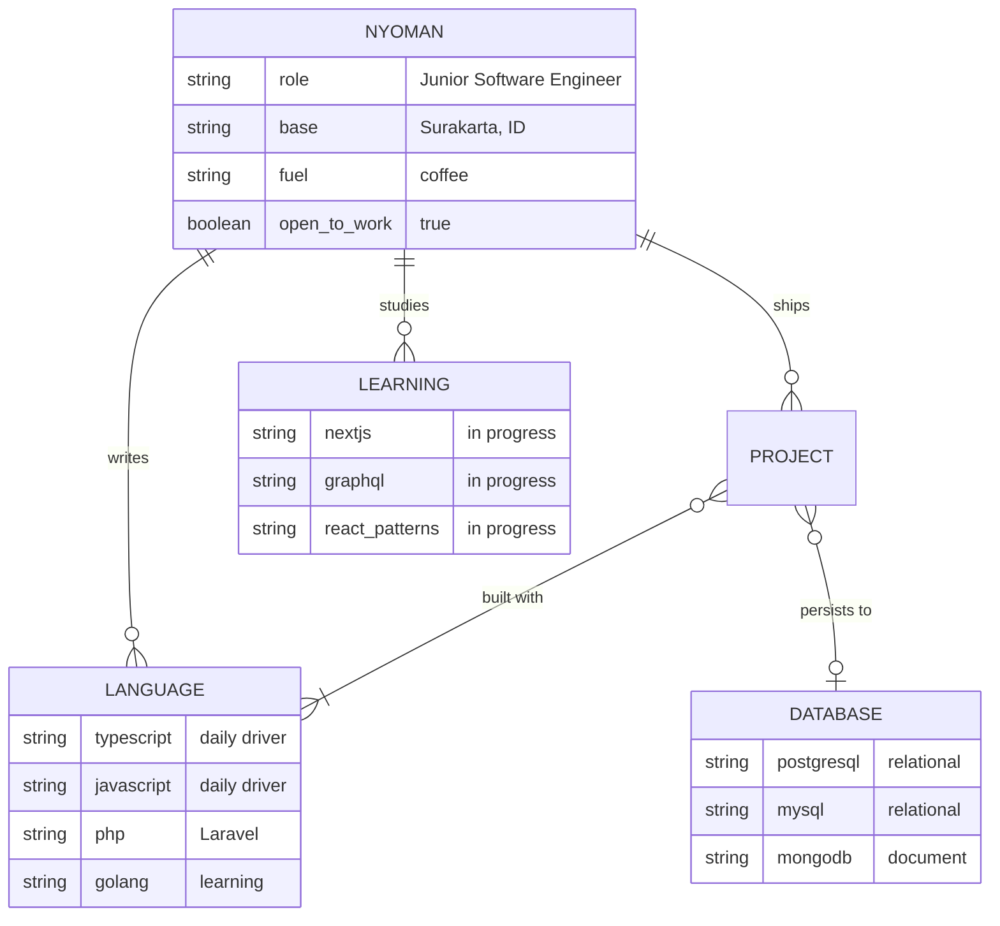
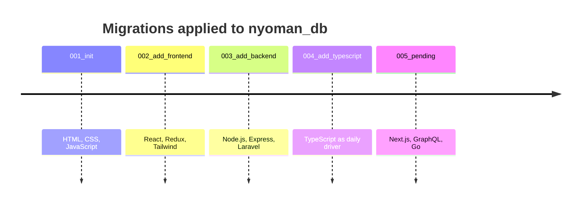

<!--
  README ini bertema "database": profil = skema, skill = tabel, perjalanan = migrasi.
  Semua diagram memakai Mermaid, yang dirender langsung oleh GitHub (tanpa server pihak ketiga).
  Ganti semua yang bertanda TODO dengan data aslimu.
-->

```sql
-- connected to: github.com/Marst313
-- server: Surakarta, Central Java, Indonesia (UTC+7)

SELECT name, role, status
FROM   developers
WHERE  username = 'Marst313';
```

| name | role | status |
|---|---|---|
| **I Nyoman Karma Dharma Nalendra Wardana** | Junior Software Engineer | `ACTIVE` — open to collaboration |

```
(1 row returned in 0.313 ms)
```

---

### `\d nyoman` — describe schema

Saya membangun aplikasi web dari ujung ke ujung: antarmuka dengan **TypeScript + React**, API dengan **Node.js / Laravel**, dan yang paling saya nikmati, **mendesain struktur data di baliknya**. Kalau ada tabel yang dinormalisasi dengan rapi, saya senang. Kalau ada query yang lambat, saya penasaran.



---

### `SELECT * FROM stack ORDER BY daily_use DESC;`

| layer | tools |
|---|---|
| `frontend` |      |
| `backend` |     |
| `database` |    |
| `infra` |     |

---

### `SELECT * FROM projects WHERE featured = true;`

<!-- TODO: ganti 3 baris ini dengan proyek aslimu. Satu kalimat masalah + satu kalimat hasil lebih kuat dari daftar fitur. -->

| project | what it solves | stack | link |
|---|---|---|---|
| **TODO-nama-proyek-1** | TODO: masalah apa yang diselesaikan, untuk siapa | `React` `TS` `PostgreSQL` | [repo](https://github.com/Marst313/TODO) · [live](https://TODO) |
| **TODO-nama-proyek-2** | TODO | `Laravel` `MySQL` | [repo](https://github.com/Marst313/TODO) |
| **inyomandharma.vercel.app** | Portofolio pribadi saya | `React` `Vercel` | [live](https://inyomandharma.vercel.app/) |

---

### `SELECT * FROM schema_migrations;` — learning journey



<details>
<summary><code>EXPLAIN ANALYZE</code> — courses</summary>

<br>

| course | status |
|---|---|
| JavaScript: From Zero to Mastery | `COMMITTED` |
| React – The Complete Guide | `IN TRANSACTION` |
| Node.js Developer Course | `IN TRANSACTION` |

</details>

---

### `SELECT stats FROM github;`

<div align="center">
  
  
</div>

---

### `INSERT INTO conversations (you, me) VALUES (?, ?);`

```sql
-- pilih koneksi favoritmu:
```

[](https://inyomandharma.vercel.app/)
[](https://www.linkedin.com/in/i-nyoman-karma-dharma-nalendra-wardana/)
[](mailto:dlegoinyoman1@gmail.com)
[](https://www.instagram.com/inyoman_dharma/)

```
COMMIT;  -- terima kasih sudah mampir ☕
```
